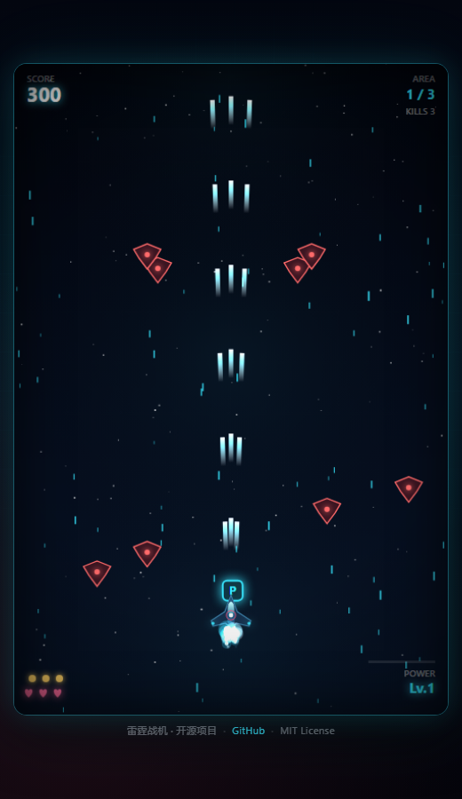

<div align="center">

# 🚀 雷霆战机 · RAIDEN STRIKE

**纯原生 HTML5 + Canvas 的街机纵版弹幕射击游戏 · 零依赖 · 零图片资源**

[](#)
[](#)
[](#)
[](#)

### ▶ [**在线试玩 https://shenyicong.github.io/raiden-strike/**](https://shenyicong.github.io/raiden-strike/)

</div>

<p align="center">
  
  <br>
  <sub>三区战役 · 分级 Boss · 五级火力 · 擦弹得分</sub>
</p>

---

## 📌 这是什么

一个**开箱即玩**的街机纵向射击游戏。致敬经典的《雷电》系列：操纵战机穿越敌方封锁线，清剿三区敌舰，击沉旗舰。

**没有任何构建工具、没有任何 npm 依赖、没有一张图片素材。** 战机、敌机、Boss、爆炸、星空全部由 Canvas 2D 路径实时绘制，音效由 WebAudio 振荡器实时合成。整个游戏就是一堆 `.js` 文件 —— 下载后用浏览器打开 `index.html` 即可。

```
git clone https://github.com/shenyicong/raiden-strike.git
cd raiden-strike
# 因为用了 ES Module，需要一个静态服务器（不能直接双击 html）
python -m http.server 8080
# 浏览器打开 http://localhost:8080
```

---

## 🎮 操作

| 按键 | 功能 |
|---|---|
| `W A S D` / `方向键` | 移动战机 |
| `空格` / `J` | 射击（**自动连发**，按住即可） |
| `K` / `X` | 炸弹：清空全屏弹幕并造成大量伤害 |
| `Shift` | 精确移动（半速，弹幕里穿针用） |
| `P` / `Esc` | 暂停 |
| `M` | 静音开关 |

**鼠标 / 触屏**：直接拖动战机，拖动期间自动开火 —— 手机上也能玩。

> 判定点只有机身中心那个**白色小点**（半径 9px），比视觉尺寸小很多，按判定点躲弹即可。

---

## ✨ 核心特性

### 战斗手感
- **五级火力进化**：单发 → 双列 → 中央重炮 + 散射 → 交替追踪弹 → 全弹幕 + 双追踪，吃 `P` 道具逐级升级，中弹掉一级。
- **擦弹爽感**：判定点小 + 精确移动模式，配合受击无敌闪烁。
- **炸弹清屏**：瞬间清空敌弹、全场伤害、屏幕白闪、强制短暂无敌 —— 危急时刻的救命键。
- **道具吸附**：靠近 130px 内的道具会被自动吸过来，不用精确对准。

### 关卡结构
- **三个区域**：近地轨道 → 陨石带 → 母舰外围，每区独立配色与波次脚本。
- **波次编队**：横排、V 字、弧线、俯冲四种阵型，逐区变强（血量 +18%/区，移速 +8%/区）。
- **三段式 Boss**：血量降到 66% / 33% 触发阶段转换 —— 弹幕密度、攻击节奏、走位幅度全部升级，四种弹幕模式轮换（瞄准散射 / 环形 / 双翼交叉针弹 / 螺旋）。
- **通关演出**：Boss 击破后连续爆炸，结算分数，进入下一区或通关。

### 视听表现
- **程序化绘制**：所有机体、弹幕、粒子、星空、UI 都是代码画出来的，改一个配色即可换风格。
- **纯 WebAudio 合成音效**：射击、爆炸、拾取、警报、通关小调 —— 不加载任何音频文件。
- **三层视差星空** + 动态星云 + 屏幕震动 + 受击白闪 + 暗角。
- **粒子池**：1400 个粒子循环复用，Boss 大爆炸一次打 100+ 粒子也不掉帧。

---

## 🗂 目录结构

```
raiden-strike/
├── index.html          # 入口页面
├── css/
│   └── style.css       # 街机外壳样式（竖屏舞台、霓虹面板、覆盖层）
└── src/
    ├── main.js         # 启动入口，绑定全局快捷键
    ├── config.js       # ★ 所有平衡性参数（改这里调难度 / 手感）
    ├── game.js         # 主类：状态机、关卡流程、实体调度、渲染
    ├── player.js       # 玩家：移动、五级火力、炸弹、受伤无敌
    ├── enemies.js      # 小怪（5 种行为）+ 三段式 Boss + 编队生成
    ├── bullets.js      # 子弹池：激光 / 光球 / 针弹 / 追踪
    ├── fx.js           # 粒子、爆炸、飘字、屏幕震动、星空
    ├── sprites.js      # 所有机型的 Canvas 矢量绘制
    ├── hud.js          # HUD：分数、生命、炸弹、火力、Boss 血条
    ├── input.js        # 键盘 / 鼠标 / 触摸统一输入
    ├── audio.js        # WebAudio 合成音效
    └── utils.js        # 数学工具、对象池
```

### 想改点什么？

| 想调整 | 改哪里 |
|---|---|
| 难度、Boss 血量、波次脚本 | `src/config.js` → `LEVELS` |
| 玩家速度 / 生命 / 无敌时间 | `src/config.js` → `PLAYER` |
| 火力等级形态 | `src/player.js` → `shoot()` |
| 子弹伤害与射速 | `src/config.js` → `WEAPON` |
| 配色主题 | `src/config.js` → `COLORS` + `LEVELS[].bg/accent` |
| 新增敌机类型 | `src/enemies.js` 的 `behavior()` + `sprites.js` 加一个绘制函数 |

---

## 🔧 技术要点

**固定逻辑分辨率 + 容器等比缩放**
游戏内部永远以 `480×720` 逻辑坐标绘制，画布用 `devicePixelRatio` 放大来保证高清；外层容器用 `aspect-ratio: 2/3` 加上 `min(94vw, (100vh-74px) * 0.667)` 双重约束，横屏、竖屏、小窗口都不会被裁切。

**帧率无关的运动**
所有位移都乘 `dt`，阻尼用指数平滑 `1 - exp(-λ·dt)` 而不是固定系数，60Hz 与 144Hz 表现一致；单帧 `dt` 上限 0.1s 防止切标签页回来后物体瞬移。

**对象池**
子弹上限 900、粒子池 1400，用 `swap-pop` 原地删除，避免 `splice` 带来的数组搬移和 GC 抖动。

**独立命中判定**
玩家碰撞半径 9px，视觉翼展约 44px。敌机也同样用 `radius * 0.82` 做宽容处理 —— 街机手感的关键从来不是"看着像碰到"，而是"感觉碰到了才算"。

---

## 📄 License

MIT License · 随便用、随便改、随便发。如果做成自己的版本，欢迎在 issue 里丢个链接。
